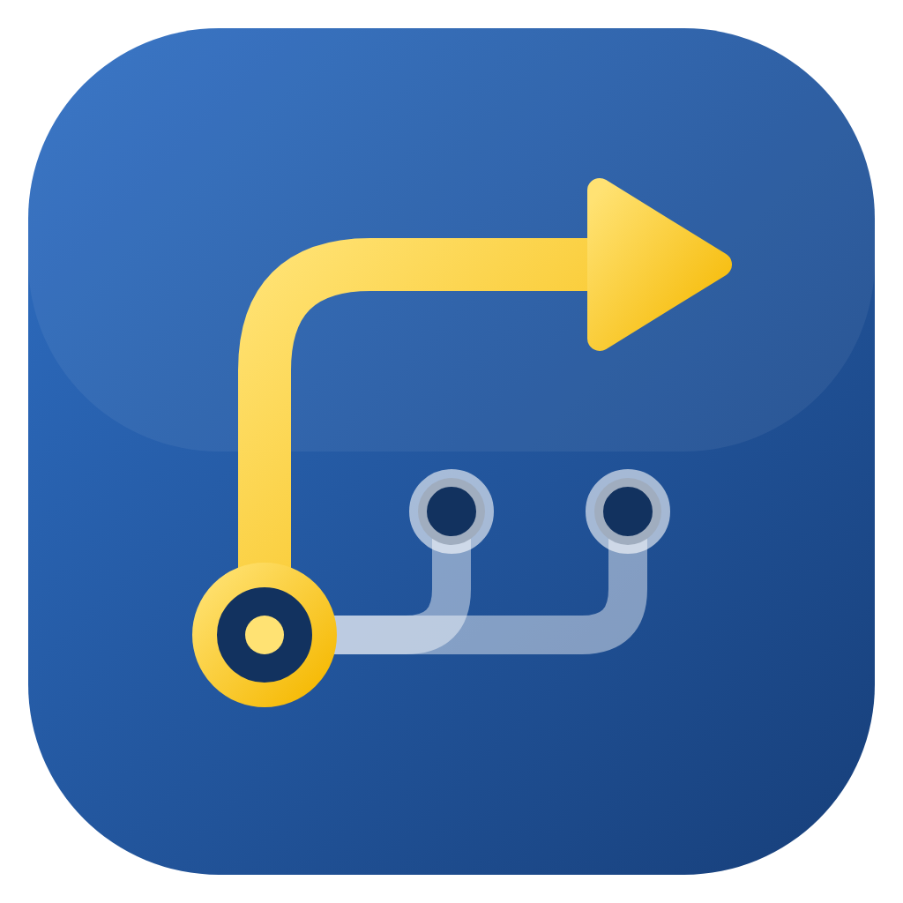

# PyPath Manager

Утилита для Windows, которая собирает в одном окне то, что обычно приходится делать руками в реестре и терминале:
выбор активного Python в `PATH`, виртуальные окружения и библиотеки через pip.

Написана на Python и PyQt6.

## Возможности

**Страница PATH**
- Находит интерпретаторы Python, зарегистрированные в реестре Windows, и показывает, какой из них сейчас активен.
  Активной считается строка, чей `python.exe` стоит первым в `PATH`.
  Если первым стоит `python.exe`, которого нет в списке,
  ни одна строка не отмечается, а под таблицей показывается путь к этому файлу.
- Делает выбранный интерпретатор активным: ставит его каталог и `Scripts` первыми в пользовательский `PATH`.
  Если Python есть и в системном `PATH`, оттуда он тоже убирается (для этого нужны права администратора).
- Откат: перед каждой сменой сохраняется снимок `PATH`, кнопка **Откатить PATH** возвращает прежнее состояние
  (подробнее в разделе «Защита PATH»).

**Страница venv**
- Создание нового окружения на выбранном Python, добавление уже существующего, удаление с диска или только из списка.
- Смена Python у окружения: venv пересоздаётся, библиотеки переустанавливаются. Если что-то пошло не так, venv
  возвращается в прежнее состояние, а список прежних библиотек сохраняется в файл (см. «Защита при смене Python»).
- Запуск `.py`-файла в выбранном окружении в новой консоли.
- Выбор окружения запоминается между запусками.

**Оформление**
- Тема в меню **Вид → Тема**: светлая, тёмная или как в системе (следует за настройкой Windows). Выбор запоминается.

**Библиотеки** (на обеих страницах)
- Список установленных пакетов, подсветка тех, для которых есть обновление, сортировка по столбцам, поиск по имени.
- Установка (в том числе конкретной версии), обновление, выбор любой доступной версии, удаление.
- Перед удалением показывается, каким пакетам удаляемые нужны. `pip`, `setuptools` и `wheel` удалить нельзя.
- Экспорт отмеченных библиотек в `requirements.txt` и импорт из него.
- Кнопка **Отмена** (Esc) прерывает текущую операцию вместе с дочерними процессами pip.

## Требования

- Windows 10/11. Программа читает реестр Windows, на других системах она не запустится.
- Python 3 (проект разрабатывался на 3.14).
- PyQt6 (точная версия в `requirements.txt`).

## Установка и запуск

**Готовый exe.** Скачайте `PyPathManager.exe` на странице [Releases](https://github.com/roloomp/PyPathManager/releases),
Python и PyQt для этого не нужны. Windows SmartScreen или антивирус могут предупредить о неподписанном файле:
это обычная реакция на программы, собранные PyInstaller и меняющие PATH.

**Из исходников:**

```
git clone https://github.com/roloomp/PyPathManager.git
cd PyPathManager
python -m venv .venv
.venv\Scripts\activate
pip install -r requirements.txt
python main.py
```

## Права администратора

Для изменения пользовательского `PATH` права администратора не нужны. Они нужны, только если нужный Python
прописан в системном `PATH`. Тогда в меню **Файл → Перезапустить от администратора** программа перезапустится
с запросом UAC. После изменения `PATH` перезапустите терминал, чтобы увидеть результат.

## Где хранятся данные

В папке `%APPDATA%\PyPathManager`:

| Файл | Что внутри |
| --- | --- |
| `settings.ini` | выбранное окружение и тема |
| `venvs.json` | список добавленных venv |
| `pypath.log` | журнал ошибок (ротация, до трёх файлов по ~0,5 МБ) |
| `path_history\*.json` | снимки PATH до и после каждой смены активного Python (хранятся последние 20) |
| `backups\*.txt` | списки библиотек, сохранённые перед сменой Python у venv (хранятся последние 20) |

При первом запуске после обновления с версии, хранившей файлы рядом с кодом, `settings.ini` и `venvs.json`
копируются из папки проекта автоматически.

## Структура проекта

```
main.py                    точка входа
pypath/
├── app.py                 сборка приложения: настройка, QApplication, окно
├── common/                то, что нужно всем слоям
│   ├── errors.py          CommandError, Cancelled
│   └── utils.py           нормализация путей и имён пакетов, ключ сортировки версий
├── config/
│   ├── paths.py           где лежат файлы программы
│   └── logs.py            настройка логирования
├── system/                низкий уровень: Windows и процессы
│   ├── registry.py        реестр: Path и список установленных Python
│   ├── admin.py           проверка прав и перезапуск через UAC
│   └── processes.py       запуск команд с таймаутом, CancelToken, завершение дерева процессов
├── services/              логика приложения, без Qt
│   ├── interpreters.py    поиск интерпретаторов, определение активного
│   ├── path_env.py        смена активного Python в Path и откат
│   ├── path_history.py    снимки PATH до и после смены
│   ├── pip.py             операции с библиотеками
│   ├── venvs.py           операции с окружениями, безопасная смена Python
│   ├── backups.py         копии списков библиотек перед опасными операциями
│   └── venv_store.py      список добавленных venv (venvs.json)
└── gui/                   интерфейс на PyQt6
    ├── main_window.py     окно, меню, прогресс
    ├── tasks.py           фоновые задачи, TaskSlot (текущая задача и кнопка «Отмена»)
    ├── widgets.py         общие виджеты и подсветка ячеек
    ├── theme.py           светлая и тёмная темы
    ├── pages/             страницы: base.py (общий класс Page), path_page.py, venv_page.py
    ├── panels/
    │   ├── libs_panel.py  сценарии работы с библиотеками (загрузка, установка, удаление...)
    │   ├── libs_table.py  таблица: отметки, сортировка, фильтр (не знает про pip)
    │   └── script_row.py  строка «файл, Обзор, Запустить»
    └── dialogs/           диалоги и справка
```

### Правила зависимостей

- `common` ничего не импортирует из проекта.
- `system` знает про Windows (`winreg`, `ctypes`, `taskkill`), но не про логику приложения.
- `services` не импортирует Qt и не обращается к `winreg` напрямую, только через `system`.
- Qt используется только в `gui` и `app.py`.

Благодаря этому логику можно проверять без окна, а всё Windows-специфичное собрано в одном месте.

### Как устроена отмена

Каждая фоновая операция получает `CancelToken` (`system/processes.py`). Пока работает pip, токен хранит его процесс.
Кнопка **Отмена** вызывает `token.cancel()`, и процесс завершается вместе с дочерними (`taskkill /T /F`).
Фоновый поток при этом получает исключение `Cancelled`, а интерфейс отличает его от ошибки команды.
Отмена установки, обновления и удаления сначала спрашивает подтверждение, потому что окружение может остаться
в промежуточном состоянии. После неё список библиотек перечитывается.

Текущую задачу и кнопку «Отмена» хранит `TaskSlot` (`gui/tasks.py`). Страницы и панель библиотек работают с ним,
а не с потоками напрямую. Если пользователь переключил интерпретатор, устаревшая задача прерывается, а её
запоздавший результат игнорируется (номер загрузки `LibsPanel.token`).

### Защита PATH

`services/path_env.set_active` не трогает реестр, пока не сохранит снимок:

1. Снимок (`path_history\*.json`) содержит значения пользовательского и системного `Path` с их типами до смены.
   Если сохранить его не удалось (например, диск заполнен), PATH не меняется.
2. Системный `Path` записывается первым. Нет прав администратора: ничего не изменено, снимок удаляется.
3. Если после записи системного `Path` не удалась запись пользовательского, системный возвращается автоматически.
4. После успеха к снимку добавляется то, что записали. По нему при откате видно, менял ли PATH кто-то ещё.

**Откатить PATH** берёт самый свежий снимок и записывает старые значения обратно. Повторное нажатие откатывает
предыдущую смену (снимки работают как стек). Если после смены PATH менялся другими программами, перед откатом
показывается предупреждение: восстановятся значения целиком, и те изменения будут потеряны. Если прав на системный
`Path` нет, пользовательский восстанавливается сразу, а снимок остаётся: перезапустите программу от администратора
и нажмите кнопку ещё раз.

### Защита при смене Python

`services/venvs.recreate` не стирает прежний venv, пока не убедится, что новый готов:

1. Список библиотек (`pip freeze`) сохраняется в `backups\`.
2. Прежняя папка переименовывается в `<venv>.old`. Если переименование не удалось (файлы заняты), ничего не меняется.
3. Создаётся новый venv и ставятся библиотеки: сначала одной командой, при сбое по одной (`--no-deps`).
4. Если venv не создался, не встала ни одна библиотека или пользователь нажал «Отмена», новая папка удаляется,
   а `.old` возвращается на место.
5. Если встала часть библиотек, остаётся новый venv, а в статусе указано, сколько не удалось установить.
   После успеха `.old` удаляется.

## Известные ограничения

- Удаление venv с диска отменить нельзя.
- Python из Microsoft Store и записи реестра без `ExecutablePath` не определяются.
- Если первым в `PATH` стоит оболочка (например, `C:\Program Files\PyManager\python.exe`), активный интерпретатор
  не отмечается: программа не запускает `python.exe`, чтобы узнать, какой Python за ним скрыт. Смена `PATH` кнопкой
  **Сделать активным** при этом может не подействовать, если оболочка лежит в системном `PATH`.
- Если во время смены Python удерживаются файлы venv (например, открыт терминал с активированным окружением),
  смена не начнётся: программа сообщит об этом и ничего не изменит.
- Откат PATH восстанавливает значения целиком: изменения, сделанные другими программами после смены, теряются
  (программа предупредит об этом).

## Сборка exe

Собирать нужно в Windows, в активированном `.venv`:

```
pip install pyinstaller
pyinstaller --noconfirm --onefile --windowed --name PyPathManager --icon assets\pypath.ico --add-data "assets;assets" main.py
```

Готовый файл появится в `dist\PyPathManager.exe`. Версия хранится в `pypath/__init__.py` (`__version__`).

## Разработка

Стиль проверяется [ruff](https://docs.astral.sh/ruff/), настройки лежат в `pyproject.toml`:

```
pip install ruff
ruff check .
```

## Лицензия

PyPath Manager распространяется под лицензией [GNU GPL v3](LICENSE) (`GPL-3.0-only`), без каких-либо гарантий.
Интерфейс построен на PyQt6, который тоже распространяется под GPL v3.